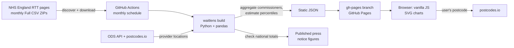

# WaitLens

**How long are people waiting for planned NHS treatment in England, and where is it quicker?**

WaitLens turns NHS England's monthly referral-to-treatment (RTT) statistics into a site where anyone can pick a specialty, enter a postcode and compare hospital providers near them: how many people are waiting, how many have waited more than 18 weeks, and how long patients who recently started treatment had waited.

**Live site: https://chandan9502.github.io/waitlens/**

[](https://github.com/chandan9502/waitlens/actions/workflows/ci.yml)
[](https://github.com/chandan9502/waitlens/actions/workflows/data.yml)

## Why

At the end of September 2026, NHS England's provider returns counted 7,074,324 pathways waiting to start consultant-led treatment. 65.9% had waited 18 weeks or less, against a constitutional standard of 92%; the median wait was 12.2 weeks and 8% had waited longer than 37.7 weeks ([NHS England press notice, 12 November 2026](https://www.england.nhs.uk/statistics/wp-content/uploads/sites/2/2026/11/Sep26-RTT-SPN-publication-PDF-391K-ojyW5x.pdf)). The government has committed to [restoring the 92% standard by March 2029](https://fullfact.org/government-tracker/cut-waiting-times-18-week-standard/), with a [national target of 70% for 2026/27](https://nhsproviders.org/resources/on-the-day-briefing-medium-term-planning-framework-2026-2029).

Patients in England usually have a [legal right to choose](https://www.nhs.uk/using-the-nhs/about-the-nhs/your-choices-in-the-nhs/) where they are referred, including many independent hospitals that treat NHS patients. The official figures that would inform that choice are published as a 100-plus-column CSV per month, split by provider, commissioner, specialty and one-week band. WaitLens does the aggregation and presents it per specialty and per provider, with a trend for each and the national picture alongside.

## What it shows

For every provider and specialty, from the latest month:

| Measure | Meaning |
| --- | --- |
| Waiting now | Pathways still waiting at the end of the month |
| Within 18 weeks | Share of those waiting 18 weeks or less, the measure behind the 92% standard |
| Median wait so far | Half the people waiting have waited longer than this |
| Over 52 weeks | Pathways waiting more than a year |
| Recently treated, admitted | Median wait of patients whose treatment needed an admission (for example surgery), pooled over the last three months |
| Recently treated, outpatient | The same for treatment that did not need an admission |
| Trend | Share within 18 weeks for each of the last 25 months |

A strip chart shows how much waits vary between providers for the chosen specialty, with the providers near the user highlighted. Every chart has a table view.

## How it works



1. `waitlens.discover` reads NHS England's yearly RTT pages and finds each month's "Full CSV data file" ZIP, preferring revised files.
2. `waitlens.rtt` reads a month, maps each "RTT Part Type" to waiting, admitted, non-admitted or new, and adds the commissioner rows together so each number describes the provider.
3. `waitlens.bands` estimates medians and 92nd percentiles by linear interpolation inside the one-week band that contains them. The vectorised version is tested against a scalar reference implementation.
4. `waitlens.build` assembles 25 months of series, pools completed pathways over the latest three months, locates providers through the NHS Organisation Data Service and postcodes.io, and writes one JSON file per specialty.
5. Every build recomputes England's totals and compares them with the figures printed in NHS England's statistical press notices. The comparison is printed in the workflow summary and shown on the site.
6. The site is static HTML, CSS and JavaScript with hand-drawn SVG charts. The only request it makes outside GitHub Pages is the postcode lookup, which goes to postcodes.io and is not stored.

## Run it yourself

```bash
git clone https://github.com/chandan9502/waitlens.git
cd waitlens
python -m pip install -e ".[dev]"

waitlens discover                         # list the monthly files NHS England has published
waitlens build --months 13 --out site/data
python -m http.server --directory site 8000
```

`waitlens build --zip FILE [FILE ...]` builds from Full CSV ZIPs you have already downloaded. `--no-geo` skips the location lookups.

## Tests

```bash
python -m pytest
ruff check .
```

The tests write small files with the same layout as the real Full CSV file and check the parsing, aggregation, percentile maths, link discovery, location fallbacks and the JSON the site reads. CI runs them on Python 3.10 to 3.13.

## Limitations

- Figures are per provider (an NHS trust or an independent provider), not per hospital site. Distances are measured to the provider's registered address. Independent providers reported as a single organisation with many sites are shown without a distance.
- Medians and 92nd percentiles are estimates from weekly bands, and are hidden where fewer than 20 pathways sit behind them.
- A provider's figures describe everyone on its list. Urgent referrals are seen sooner, and an individual's wait depends on their condition. WaitLens is not medical advice.
- When a trust does not submit data for a month, it is missing for that month, as in NHS England's provider tables.

## Data and licence

Contains public sector information from NHS England licensed under the [Open Government Licence v3.0](https://www.nationalarchives.gov.uk/doc/open-government-licence/version/3/). Provider locations come from the NHS Organisation Data Service and [postcodes.io](https://postcodes.io).

WaitLens is an independent project and is not affiliated with or endorsed by the NHS. The code is released under the MIT licence.
